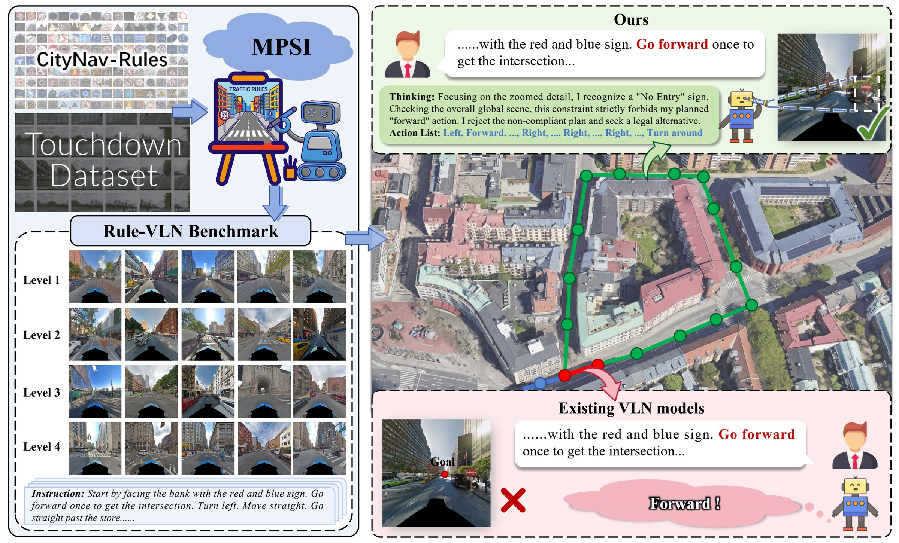
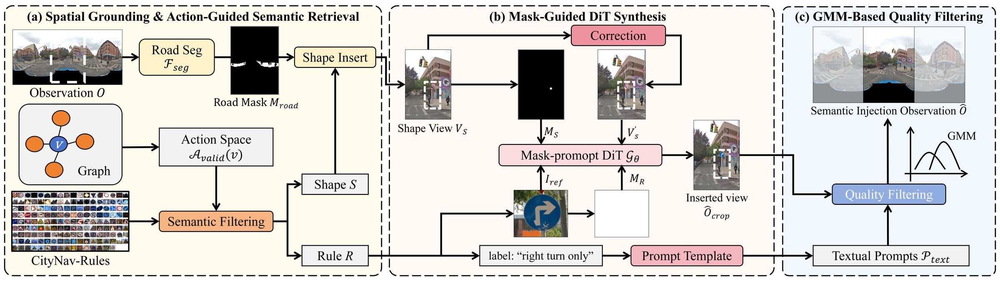
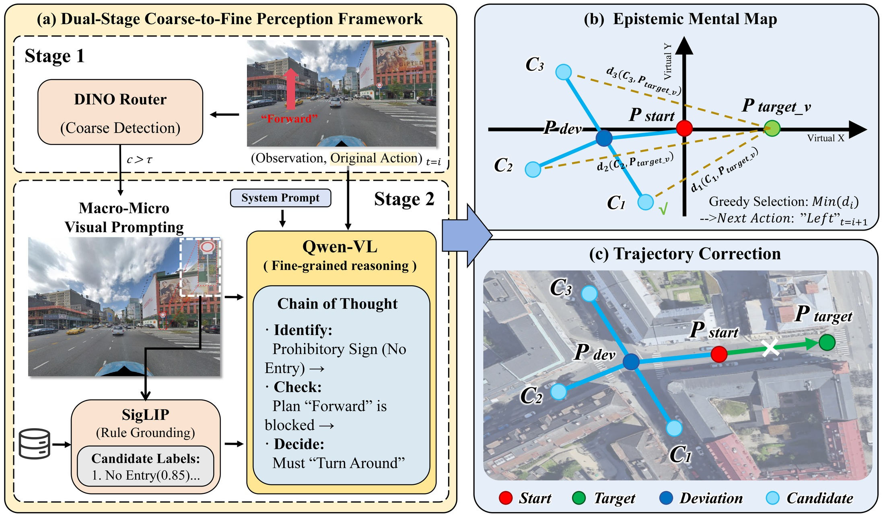
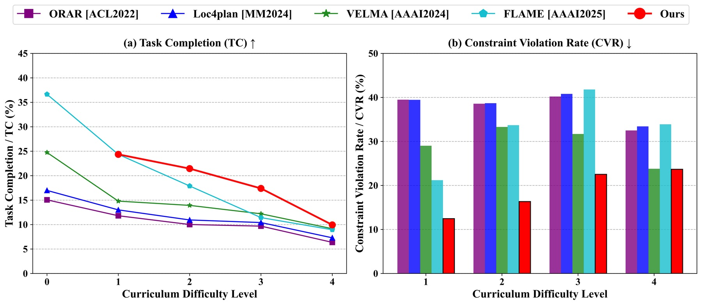
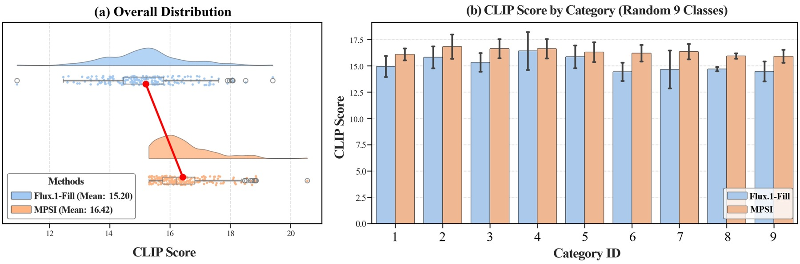
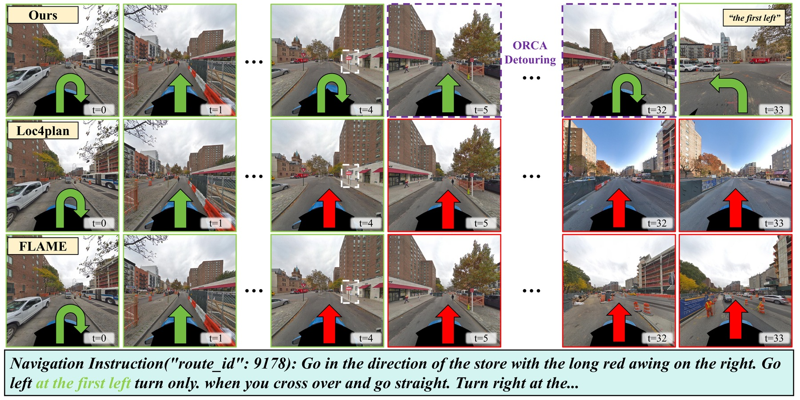

# Rule-VLN: Bridging Perception and Compliance via Semantic Reasoning and Geometric Rectification (ECCV 2026)

<p align="center">
  <a href="https://jeffry-wen.github.io/Rule-VLN/">Project Page</a> |
  <a href="https://arxiv.org/abs/2604.16993">Paper</a> |
  <a href="https://huggingface.co/datasets/jeffry77/Rule-VLN">Dataset</a> |
  <a href="https://github.com/Jeffry-wen/Rule-VLN">Code</a>
</p>

<p align="center">
  <a href="https://arxiv.org/abs/2604.16993"></a>
  <a href="https://huggingface.co/datasets/jeffry77/Rule-VLN"></a>
  
  
</p>

<p align="center">
  <b>Rule-VLN: Bridging Perception and Compliance via Semantic Reasoning and Geometric Rectification</b>
</p>

<p align="center">
  Jiawen Wen, Penglei Sun, Wenjie Zhang, Suixuan Qiu, Weisheng Xu, Xiaofei Yang, Xiaowen Chu
</p>

<p align="center">
  
</p>

Rule-VLN studies a safety-critical gap in outdoor vision-and-language navigation: an agent may be able to move through a street geometrically, but may not be allowed to do so under semantic traffic rules. We introduce a large-scale rule-compliant urban navigation benchmark and a plug-and-play Semantic Navigation Rectification Module (SNRM) that equips pre-trained navigation agents with rule awareness.

This repository contains the released Rule-VLN codebase, including the FLAME-based navigation framework, SNRM evaluation, MPSI rule-image construction, Touchdown data preparation utilities, and scripts for reproducing the released assets and evaluation protocol.

## News

- **2026-06**: Rule-VLN was accepted to ECCV 2026.
- **2026-04**: Rule-VLN preprint is available on arXiv.

## Contents

- [Highlights](#highlights)
- [Method Overview](#method-overview)
- [Repository Layout](#repository-layout)
- [Installation](#installation)
- [Released Assets](#released-assets)
- [Touchdown Data Preparation](#touchdown-data-preparation)
- [MPSI Benchmark Construction](#mpsi-benchmark-construction)
- [Evaluation](#evaluation)
- [Training](#training)
- [Validation](#validation)
- [Acknowledgements](#acknowledgements)
- [Citation](#citation)

## Highlights

- **Rule-compliant VLN benchmark**: Rule-VLN injects semantic traffic-rule constraints into Touchdown-style urban navigation.
- **Large-scale constrained graph**: The benchmark spans a 29k-node urban environment with 8k constrained nodes and 177 regulatory categories.
- **Curriculum difficulty**: Four benchmark levels progressively increase the impact of rule-constrained nodes.
- **MPSI generation pipeline**: Mask-Prioritized Semantic Injection inserts rule signs into panoramic observations with geometry-aware placement and quality filtering.
- **SNRM rectification**: A zero-shot module combines coarse-to-fine rule perception with an epistemic mental map for compliant detour planning.
- **Evaluation metrics**: TC, SPD, SED, SPL, and CVR are supported for rule-aware navigation analysis.

## Method Overview

### Rule-VLN Benchmark

<p align="center">
  
</p>

Rule-VLN builds on the Touchdown graph and introduces dynamic semantic constraints. A route that is physically reachable may be invalid if the relevant observation contains a regulatory sign that prohibits the intended action. The benchmark therefore tests whether agents can answer not only "can I go?", but also "may I go?".

### Semantic Navigation Rectification Module

<p align="center">
  
</p>

SNRM is a plug-and-play, zero-shot rectification module. It first detects candidate rule regions, grounds the rule semantics with a coarse-to-fine perception pipeline, and then updates a local epistemic mental map to prune illegal actions and choose compliant detours.

### Results

<p align="center">
  
</p>

<p align="center">
  
</p>

<p align="center">
  
</p>

## Repository Layout

```text
Rule-vln/
|-- assets/                  # README figures from the Rule-VLN paper
|-- configs/                 # Training, evaluation, DeepSpeed, and asset configs
|-- data/touchdown/          # Navigation splits, graph, and Level 1-4 manifests
|-- docs/                    # GitHub Pages project website
|-- llm_nav/                 # FLAME model, data, simulator, planner, and SNRM/SNA logic
|-- MPSI/                    # Mask-Prioritized Semantic Injection subproject
|-- scripts/                 # Asset download, data preparation, training, and evaluation scripts
|-- tools/                   # Graph conversion, panorama projection, LMDB, and feature utilities
|-- train_flame.py           # FLAME fine-tuning entry point
`-- evaluate_sna.py          # Rule-aware navigation evaluation entry point
```

## Installation

The main environment is designed for Python 3.10, PyTorch 2.5.1, CUDA 12.4, and Transformers 4.57.3. It uses PyTorch native scaled dot-product attention and does not require a CUDA-specific xFormers binary.

```bash
conda env create -f environment.yml
conda activate rule_vln
```

If `flash-attn` cannot be built during the Conda pip phase, install the remaining environment first and then run:

```bash
pip install flash-attn==2.8.3 --no-build-isolation
pip install -e ".[dev]"
```

## Released Assets

Large assets are hosted on Hugging Face:

```text
https://huggingface.co/datasets/jeffry77/Rule-VLN
```

Download and normalize the released assets:

```bash
python scripts/download_assets.py \
  --repo-id jeffry77/Rule-VLN \
  --output-root .
```

The downloader maps the historical remote layout into the following local paths:

```text
data/features/flame_clip_touchdown_120_crop_lmdb/
data/features/flame_clip_touchdown_insert_120_crop_lmdb/
data/touchdown/insert_touchdown/
data/touchdown/data/
data/touchdown/ft_data/
checkpoints/Flame_checkpoint-2500/
```

Raw StreetLearn/Touchdown panoramas are not redistributed in this repository. Please obtain them from the official dataset provider and follow their license and usage terms.

## Touchdown Data Preparation

Download the Manhattan StreetLearn/Touchdown data from the official [StreetLearn dataset page](https://sites.google.com/view/streetlearn/dataset?authuser=0). The expected local layout is:

```text
/path/to/touchdown/
|-- jpegs_manhattan_touchdown_2022/
|-- manhattan_touchdown_metadata_nodes.tsv
`-- manhattan_touchdown_metadata_links.tsv
```

Convert metadata and project panoramas into 120-degree FLAME views:

```bash
python scripts/prepare_touchdown.py \
  --streetlearn-root /path/to/touchdown \
  --output-root data/touchdown \
  --project-views \
  --view-output data/images/touchdown_crop_120

python tools/build_image_lmdb.py \
  --image-dir data/images/touchdown_crop_120 \
  --output-dir data/images/touchdown_crop_120_lmdb
```

The released graph is included under `data/touchdown/graph/`. By default, `prepare_touchdown.py` keeps this graph and validates it before projection. Use `--rebuild-graph` only when constructing a new benchmark variant.

## MPSI Benchmark Construction

MPSI uses a separate environment because its diffusion and segmentation dependencies differ from the main navigation environment.

```bash
conda env create -f environment-mpsi.yml
conda activate rule_vln_mpsi
pip install -e ./MPSI
```

Generate all four curriculum levels:

```bash
for level in 1 2 3 4; do
  python -m mpsi.cli build \
    --config MPSI/configs/touchdown.yaml \
    --level "$level" \
    --output-dir "outputs/mpsi/task${level}"
done
```

Project inserted panoramas and build the raw-image LMDB:

```bash
mkdir -p data/images/touchdown_insert_crop_120

for level in 1 2 3 4; do
  python tools/project_panoramas.py \
    --panorama-dir "outputs/mpsi/task${level}/inserted_panoramas" \
    --nodes data/touchdown/graph/nodes.txt \
    --links data/touchdown/graph/links.txt \
    --output-dir data/images/touchdown_insert_crop_120 \
    --fov 120 \
    --size 1500
done

python tools/build_image_lmdb.py \
  --image-dir data/images/touchdown_insert_crop_120 \
  --output-dir data/images/touchdown_insert_crop_120_lmdb
```

MPSI records selected rules, shape templates, node seeds, diffusion seeds, CLIP scores, and image checksums in `generation_manifest.jsonl`.

## Evaluation

Return to the main environment:

```bash
conda activate rule_vln
```

Evaluate one curriculum level:

```bash
python evaluate_sna.py \
  --config configs/eval_touchdown.yaml \
  --level 1
```

Evaluate all levels:

```bash
bash scripts/evaluate_all_levels.sh
```

Configuration values can be overridden with `--set`:

```bash
python evaluate_sna.py \
  --config configs/eval_touchdown.yaml \
  --level 2 \
  --set data.eval_data_size=100 \
  --set sna.save_debug=true
```

Outputs are written to `outputs/eval/` and include the resolved level, metrics, trajectories, model responses, and visited image IDs.

### Metrics

- **TC**: task completion rate.
- **SPD**: shortest-path distance from the final node to the target.
- **SED**: success-weighted edit similarity.
- **SPL**: success weighted by path efficiency.
- **CVR**: constraint violation rate over rule-exposed steps; lower is better.

## Training

The default configuration starts from [`xyz9911/FLAME-init`](https://huggingface.co/xyz9911/FLAME-init), uses the released base feature LMDB, and follows the FLAME supervised fine-tuning path.

```bash
conda activate rule_vln
bash scripts/train_touchdown.sh configs/train_touchdown.yaml
```

Equivalent direct command:

```bash
deepspeed train_flame.py --config configs/train_touchdown.yaml
```

The reference setup used four H100 GPUs. Adjust `global_batch_size`, `micro_batch_size`, or DeepSpeed settings in the YAML for different hardware. The published evaluation checkpoint is:

```text
checkpoints/Flame_checkpoint-2500/
```

## Self-Consistent Reconstruction

The released inserted feature LMDB was generated from an earlier stochastic MPSI run. Newly generated MPSI images are not expected to be pixel-identical. The default evaluation path reproduces the method and uses the released inserted features, so small metric differences are possible.

For a fully self-consistent reconstruction, extract features from the inserted raw-image LMDB generated by your MPSI run:

```bash
python tools/extract_flame_features.py \
  --image-lmdb data/images/touchdown_insert_crop_120_lmdb \
  --output-lmdb data/features/flame_clip_touchdown_insert_120_crop_lmdb_rebuilt \
  --model-path xyz9911/FLAME-init \
  --batch-size 64

python evaluate_sna.py \
  --config configs/eval_touchdown.yaml \
  --level 1 \
  --set data.img_insert_db=data/features/flame_clip_touchdown_insert_120_crop_lmdb_rebuilt
```

## Validation

Run lightweight checks:

```bash
python scripts/validate_assets.py --level 1 --check-raw
python -m pytest -q
```

GPU-heavy tests are not part of the default unit suite. Before publishing new assets, additionally run one MPSI image generation, one full navigation route, and all four evaluation levels on the intended GPU environment.

## License and External Assets

The main code is released under the Apache-2.0 license. Minimal third-party inference subsets preserve their upstream licenses under `MPSI/third_party/`.

StreetLearn panoramas, CityNav-Rules images, FLUX weights, model checkpoints, and other downloaded models remain subject to their respective licenses and terms.

## Acknowledgements

We thank [FLAME](https://github.com/xyz9911/FLAME) for providing the navigation framework that Rule-VLN builds upon. We also thank the [StreetLearn/Touchdown dataset](https://sites.google.com/view/streetlearn/dataset?authuser=0) for providing the Touchdown panoramic images used in this work.

## Citation

If you find Rule-VLN useful, please cite:

```bibtex
@inproceedings{wen2026rule,
  title={Rule-VLN: Bridging Perception and Compliance via Semantic Reasoning and Geometric Rectification},
  author={Wen, Jiawen and Sun, Penglei and Zhang, Wenjie and Qiu, Suixuan and Xu, Weisheng and Yang, Xiaofei and Chu, Xiaowen},
  booktitle={European Conference on Computer Vision},
  pages={465--483},
  year={2026},
  organization={Springer}
}
```
